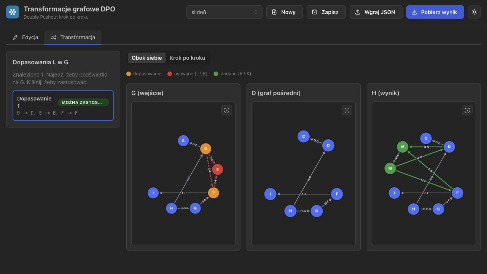

# DPO w transformacjach grafowych

Program wykonuje jeden krok Double Pushout na skończonym grafie skierowanym. Dane wejściowe zawierają graf, regułę i ręcznie wskazane dopasowanie. Pętle i równoległe krawędzie są dozwolone.

## Uruchomienie

Z katalogu projektu, z Pythonem 3.11+ i `uv`:

```sh
uv run python dpo.py examples/slide8.json --output-dir wynik/udany --csv --excel
uv run python dpo.py examples/slide8_rejected.json --output-dir wynik/odrzucony --csv --excel
```

Każde uruchomienie na poprawnym wejściu zapisuje `output.json`. Flaga `--csv` zapisuje dodatkowo `wierzcholki.csv`, `krawedzie.csv` i `status.csv`. Pliki używają UTF-8 z BOM oraz średnika jako separatora. Identyfikatory wyglądające jak formuły są w CSV poprzedzane apostrofem. Flaga `--excel` zapisuje te same tabele w trzech arkuszach pliku `wynik.xlsx`, z identyfikatorami zapisanymi jako tekst. W tabelach wierzchołków i krawędzi kolumna `etap` pozwala wybrać stan grafu. Przy udanej transformacji są trzy etapy. Przy odrzuceniu eksport zawiera graf wejściowy oraz przyczynę odrzucenia.

Kod wyjścia `0` oznacza wykonaną transformację, `3` odrzucenie reguły z zapisem wyniku, a `1` błąd danych lub pliku. Domyślny katalog wyjściowy to `wynik`. Polecenia używają osobnych podkatalogów, żeby wyniki obu prób były dostępne obok siebie.

## Interfejs graficzny

Pierwsze uruchomienie wymaga zbudowania frontendu (Node 20.19+ lub 22.12+):

```sh
cd frontend && npm install && npm run build && cd ..
uv run dpo-ui
```

Polecenie uruchamia serwer na `http://127.0.0.1:8000` i otwiera przeglądarkę. Opcje: `--port` oraz `--no-browser`.

W zakładce „Edycja” rysujesz G, L i R. Dwuklik na tle dodaje wierzchołek, a w trybie „Rysowanie krawędzi” przeciągnięcie łączy dwa wierzchołki. Elementy o tym samym id w L i R tworzą K i mają fioletową obwódkę. Edytor JSON obok płócien jest zsynchronizowany z rysunkiem. „Zapisz” zapisuje przykład w `examples/` razem z pozycjami wierzchołków (pole `layout`, które CLI pomija). Plik zawiera `match`, jeśli wybrano dopasowanie, więc można go potem uruchomić przez `dpo.py`.

Zakładka „Transformacja” wyszukuje wszystkie injektywne dopasowania L w G (najwyżej 200) i oznacza te, które łamią warunek wiszącej krawędzi. Po wyborze dopasowania widać G, D i H obok siebie albo animację krok po kroku, a wynik można pobrać jako JSON, CSV lub Excel.

Praca nad frontendem z automatycznym przeładowaniem: `uv run dpo-ui --no-browser` w jednym terminalu i `npm run dev` w `frontend/` w drugim.

### Podgląd aplikacji

Edytor grafu G i reguły L ← K → R z podglądem JSON:


Transformacja przykładu `slide8`: dopasowanie, elementy usuwane i dodane oraz grafy G, D i H:



Odrzucone usunięcie wierzchołka B: krawędź `bc` pozostałaby bez końca. Drugie dopasowanie tej samej reguły jest dozwolone:


## Gotowe przykłady

Wybierz nazwę z listy w UI albo uruchom plik przez CLI. Każdy przykład zawiera gotowe `match`; wynik opisany poniżej dotyczy właśnie tego dopasowania. W UI możesz wybrać również inne znalezione dopasowania.

- [subdivide_edge.json](examples/subdivide_edge.json) - zastępuje A → B ścieżką A → m → B; zachowuje końce krawędzi i pozostałą część grafu.
- [reverse_edge.json](examples/reverse_edge.json) - usuwa A → B i dodaje B → A bez usuwania wierzchołków.
- [parallel_edges.json](examples/parallel_edges.json) - dwie równoległe krawędzie A → B dają dwa dopasowania. Wybrana krawędź zostaje odwrócona, druga pozostaje.
- [remove_loop.json](examples/remove_loop.json) - usuwa pętlę A → A, zachowując A oraz krawędź A → B.
- [remove_leaf.json](examples/remove_leaf.json) - usuwa końcowy wierzchołek C wraz z B → C; warunek wiszącej krawędzi jest spełniony.
- [remove_vertex_rejected.json](examples/remove_vertex_rejected.json) - próba usunięcia B wraz z A → B jest odrzucona przez pozostającą B → C (`bc`). Wybór drugiego dopasowania pozwala zamiast tego usunąć C.
- [slide8.json](examples/slide8.json) - większy przykład z materiałów: usuwanie fragmentu grafu i dodawanie nowych wierzchołków oraz krawędzi.
- [slide8_rejected.json](examples/slide8_rejected.json) - wariant poprzedniego przykładu, w którym dodatkowa krawędź E → C blokuje zapisane dopasowanie.

### Większe scenariusze

Te przykłady mają od 8 do 11 wierzchołków i pokazują wpływ reguły na większy kontekst. Liczby dopasowań dotyczą całego wyszukiwania w UI, a opis transformacji dotyczy zapisanego `match`.

- [pipeline_bypass.json](examples/pipeline_bypass.json) - sieć z 10 wierzchołkami, monitorem, archiwum i pętlą. Usunięcie B zastępuje A → B → C połączeniem A → C. Spośród 8 dopasowań 6 jest dozwolonych; dodatkowe połączenia mogą zablokować usunięcie innego węzła.
- [pipeline_bypass_rejected.json](examples/pipeline_bypass_rejected.json) - dodatkowa krawędź `monitor-b` blokuje zapisane usunięcie B. W całej sieci jest 9 dopasowań, z czego 5 można zastosować.
- [diamond_expand.json](examples/diamond_expand.json) - dwa połączone „diamenty”, sprzężenie zwrotne i zewnętrzny monitor. Pierwszy diament zostaje rozbudowany do czterech nowych węzłów, a drugi i jego otoczenie pozostają zachowane. Są 4 dopasowania, ponieważ ramiona diamentu można zamienić miejscami.
- [parallel_bundle.json](examples/parallel_bundle.json) - sieć z wiązkami dwóch i trzech równoległych krawędzi. Reguła zachowuje jedną krawędź w K, a drugą zastępuje ścieżką przez `relay`; trzecia pozostaje częścią kontekstu. Łącznie 8 dopasowań różniących się wyborem krawędzi.
- [loop_cleanup_network.json](examples/loop_cleanup_network.json) - cykl i dalszy łańcuch z czterema pętlami, w tym dwiema równoległymi. Wybrana pętla na D zostaje zastąpiona odgałęzieniem do `marker`; pozostałe połączenia i pętle nie zmieniają się.
- [name_collisions.json](examples/name_collisions.json) - w grafie istnieją już `relay`, `relay_1`, `relay_2` oraz nazwy nowych krawędzi. Reguła dodaje więc `relay_3`, `to-relay_2` i `from-relay_1`, zachowując dotychczasowe elementy o kolidujących nazwach.
- [connect_components.json](examples/connect_components.json) - dwa osobne cykle i rozłączny łańcuch. Reguła wybiera dwa różne wierzchołki i dodaje pomost przez `bridge`. Jest 90 dopasowań; zapisane dopasowanie łączy pierwszy i drugi cykl. Inne wybory mogą połączyć wierzchołki tej samej składowej.
- [cycle_no_match.json](examples/cycle_no_match.json) - rozgałęziony graf acykliczny i reguła szukająca skierowanego trójkąta. UI pokazuje zero dopasowań. Plik celowo nie zawiera `match`: nadaje się do wyszukiwania w UI, a CLI zgłasza brak dopasowania wejściowego (kod `1`).

Na przykład:

```sh
uv run python dpo.py examples/subdivide_edge.json --output-dir wynik/podzial
uv run python dpo.py examples/remove_vertex_rejected.json --output-dir wynik/wiszaca
```

Druga komenda zapisuje odrzucenie z `edge_id: "bc"` i zwraca kod wyjścia `3`.

## Schemat JSON (wejście)

Plik wejściowy to jeden obiekt z polami `graph`, `rule` i `match`:

```json
{
  "graph": {
    "nodes": ["…"],
    "edges": [{ "id": "…", "source": "…", "target": "…" }]
  },
  "rule": {
    "L": { "nodes": ["…"], "edges": [{ "id": "…", "source": "…", "target": "…" }] },
    "K": { "nodes": ["…"], "edges": [{ "id": "…", "source": "…", "target": "…" }] },
    "R": { "nodes": ["…"], "edges": [{ "id": "…", "source": "…", "target": "…" }] }
  },
  "match": {
    "nodes": { "<id z L>": "<id w G>" },
    "edges": { "<id krawędzi z L>": "<id krawędzi w G>" }
  }
}
```

Wymagania:

| Element | Opis |
|---|---|
| graf (`graph`, `L`, `K`, `R`) | `nodes`: unikalne niepuste stringi; `edges`: unikalne `id`, `source`/`target` muszą istnieć w `nodes` |
| `rule.K` | każdy wierzchołek i krawędź z `K` musi występować w `L` i `R` z tymi samymi końcami |
| `match.nodes` / `match.edges` | dokładnie wszystkie id z `L`, wartości różne i istniejące w `G`; dopasowanie krawędzi zachowuje źródło i cel |

## Jak działa reguła

- `graph` to graf wejściowy \(G\).
- `rule.L` opisuje szukany fragment, `rule.K` elementy zachowane, a `rule.R` fragment po zmianie. Elementy zachowane mają te same identyfikatory w `K`, `L` i `R`. Element spoza `K` jest traktowany jako osobny element po każdej stronie reguły.
- `match` mapuje identyfikatory z `L` na identyfikatory w `G`.
- Program sprawdza, czy usunięcie elementów z \(L \setminus K\) pozostawiłoby krawędź bez końca. Jeśli tak, zwraca `dangling_edge` oraz identyfikator tej krawędzi. W przeciwnym razie tworzy graf pośredni `intermediate_graph` i dołącza elementy z \(R \setminus K\) przez zachowaną część, tworząc `result_graph`.

Przykład `slide8.json` odwzorowuje skierowane krawędzie z ostatniego slajdu „SPO I DPO”. Program usuwa `E` wraz z `D → E` i `F → E` oraz usuwa `D → F`. Zachowuje `D` i `F` z ich pozostałymi połączeniami, po czym dodaje `M`, `N` i pięć krawędzi z `R`. Litery z rysunku służą jako identyfikatory. W `slide8_rejected.json` dodatkowa krawędź `E → C` blokuje tę samą regułę.

## Schemat JSON (wynik)

Przy sukcesie (`status: "applied"`):

```json
{
  "status": "applied",
  "intermediate_graph": { "nodes": ["…"], "edges": [{ "id": "…", "source": "…", "target": "…" }] },
  "result_graph": { "nodes": ["…"], "edges": [{ "id": "…", "source": "…", "target": "…" }] }
}
```

Przy odrzuceniu (`status: "rejected"`):

```json
{
  "status": "rejected",
  "reason": "dangling_edge",
  "edge_id": "…"
}
```

## Gdzie jest kod

`dpo.py` uruchamia program. Kod znajduje się w `src/graph_dpo/`:

| Moduł | Za co odpowiada |
|---|---|
| `models.py` | Reprezentacja grafu, reguły, dopasowania i wyniku |
| `validation.py` | Odczyt struktury wejściowej i sprawdzanie dopasowania |
| `rewrite.py` | Warunek wiszącej krawędzi oraz konstrukcja grafów pośredniego i wynikowego |
| `exports.py` | Zapis JSON, CSV i Excela |
| `cli.py` | Argumenty polecenia, odczyt pliku i komunikaty |
| `matching.py` | Wyszukiwanie dopasowań i warunek wiszącej krawędzi |
| `api.py` | Endpointy HTTP dla interfejsu |
| `server.py` | Polecenie `dpo-ui` |

Frontend znajduje się w `frontend/src`: logika w `lib/`, komponenty w `components/`.

## Sprawdzenie projektu

```sh
uv run python -m pytest -q
uv run ruff check .
cd frontend && npm test && npm run typecheck
```

Testy backendu obejmują wszystkie przykłady przez API, większe przykłady przez CLI, dokładne wyniki transformacji i zachowanie kontekstu dla każdego znalezionego dopasowania. Wyszukiwanie dopasowań jest porównywane z niezależnym przeglądem wszystkich injektywnych odwzorowań na 20 małych grafach z ustalonymi ziarnami losowania i 6 wzorcach (120 przypadków). Osobne przypadki sprawdzają błędne dane, nieinjektywne odwzorowania, warunek wiszącej krawędzi dla krawędzi przychodzących, wychodzących i pętli, puste grafy, tworzenie i usuwanie całej składowej, kolizje nazw oraz granicę limitu dopasowań.
