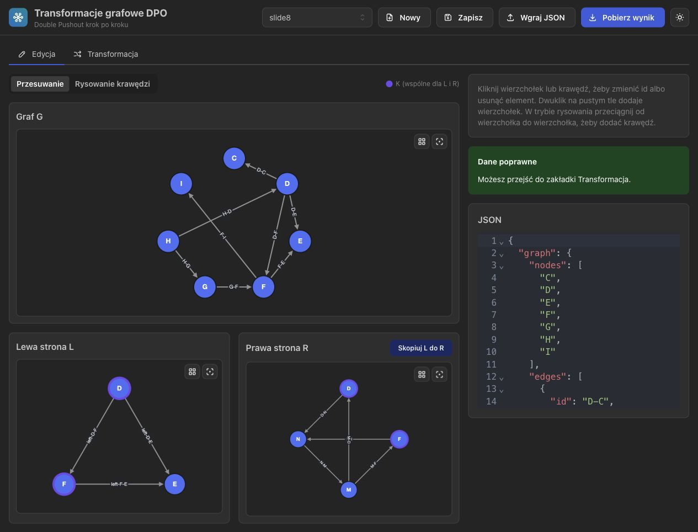
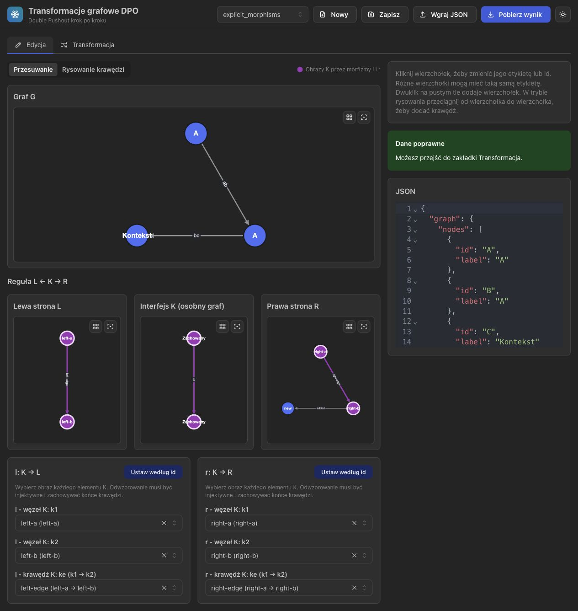
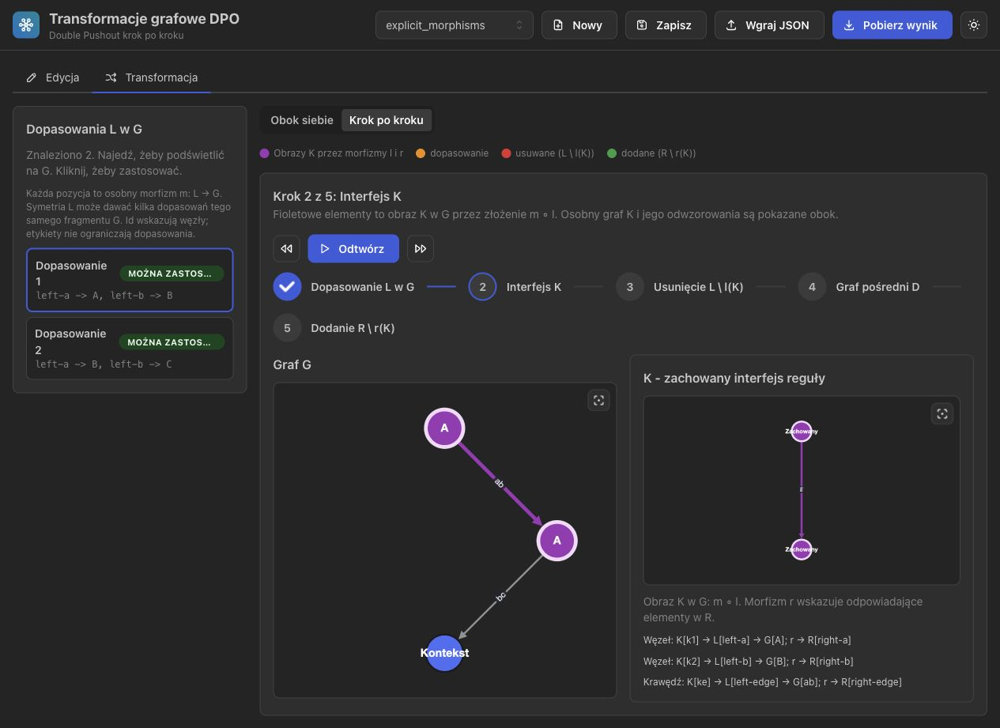
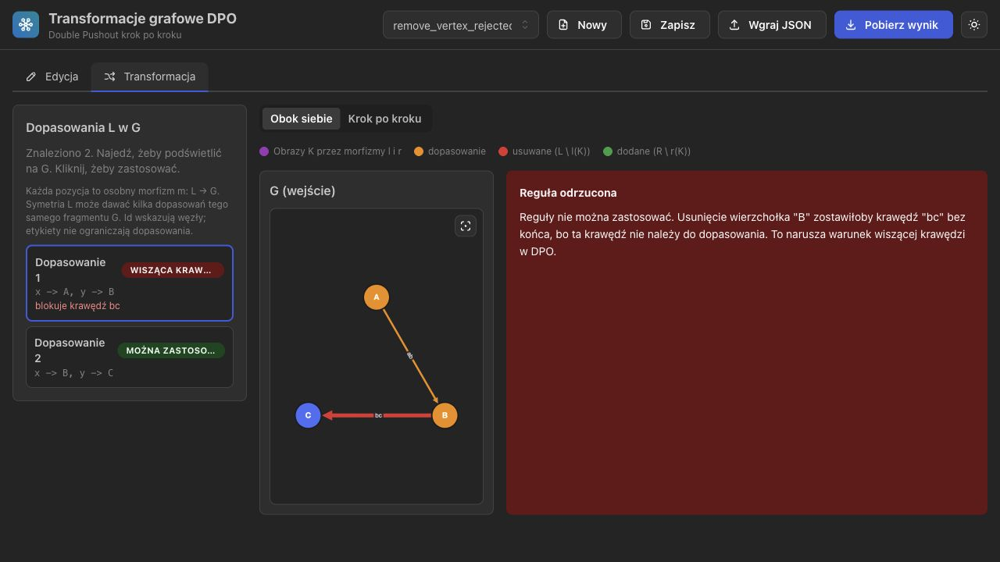
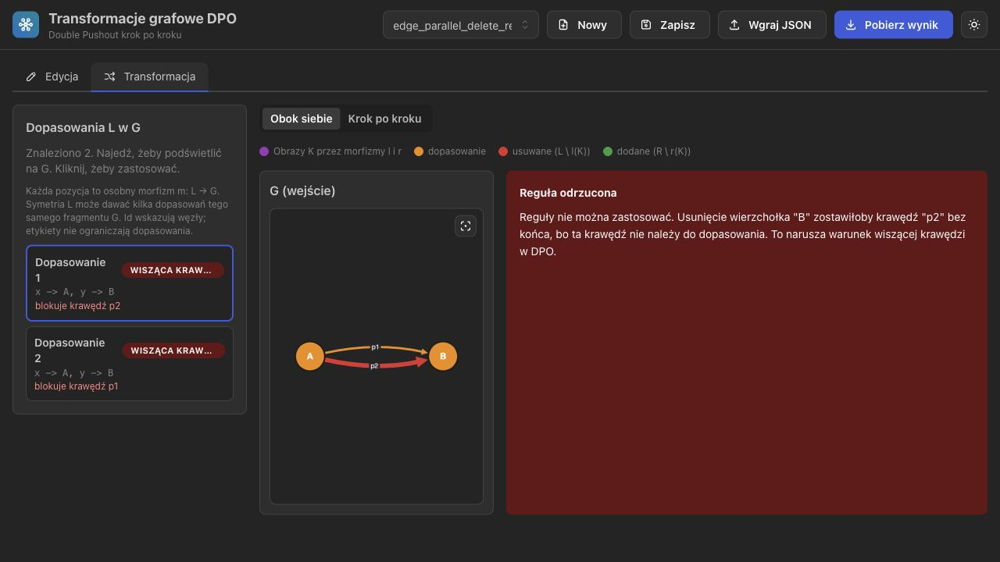
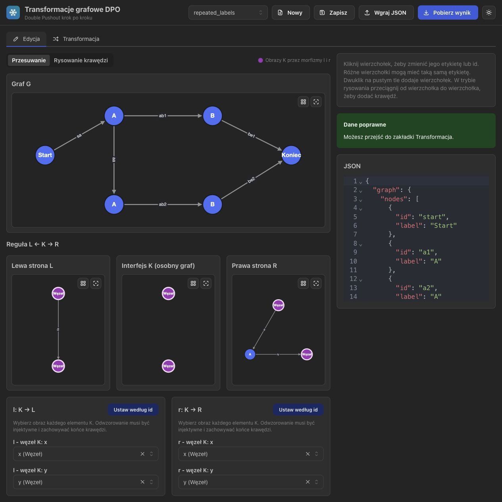

# DPO w transformacjach grafowych

Program wykonuje jeden krok Double Pushout (DPO) na skończonym grafie skierowanym. Reguła składa się z trzech osobnych grafów L ← K → R i dwóch morfizmów `l: K → L` oraz `r: K → R`. W UI można narysować grafy i wybrać automatycznie znalezione dopasowanie `m: L → G`; CLI przyjmuje dopasowanie zapisane w JSON-ie. Pętle i krawędzie równoległe są dozwolone.

Każdy węzeł jest obiektem z obowiązkowymi polami `id` i `label`. Id identyfikuje element w danym grafie, a etykieta jest tekstem na rysunku. Różne węzły mogą mieć takie same etykiety. Dopasowanie zależy od struktury i kierunków krawędzi; etykiety nie są porównywane. Program nie implementuje wildcardów.

## Uruchomienie

Z katalogu projektu, z Pythonem 3.11+ i `uv`:

```sh
uv run python dpo.py examples/slide8.json --output-dir wynik/udany --csv --excel
uv run python dpo.py examples/slide8_rejected.json --output-dir wynik/odrzucony --csv --excel
```

Każde uruchomienie na poprawnym wejściu zapisuje `output.json`. Flaga `--csv` zapisuje dodatkowo `wierzcholki.csv`, `krawedzie.csv` i `status.csv`. Pliki używają UTF-8 z BOM oraz średnika jako separatora. Identyfikatory i etykiety wyglądające jak formuły są w CSV poprzedzane apostrofem. Flaga `--excel` zapisuje te same tabele w trzech arkuszach pliku `wynik.xlsx`, z identyfikatorami zapisanymi jako tekst. W tabelach wierzchołków i krawędzi kolumna `etap` pozwala wybrać stan grafu. Przy udanej transformacji są trzy etapy. Przy odrzuceniu eksport zawiera graf wejściowy oraz przyczynę odrzucenia.

Kod wyjścia `0` oznacza wykonaną transformację, `3` odrzucenie reguły z zapisem wyniku, a `1` błąd danych lub pliku. Domyślny katalog wyjściowy to `wynik`. Polecenia używają osobnych podkatalogów, żeby wyniki obu prób były dostępne obok siebie.

## Interfejs graficzny

Pierwsze uruchomienie wymaga zbudowania frontendu (Node 20.19+ lub 22.12+):

```sh
cd frontend && npm install && npm run build && cd ..
uv run dpo-ui
```

Polecenie uruchamia serwer na `http://127.0.0.1:8000` i otwiera przeglądarkę. Opcje: `--port` oraz `--no-browser`.

W zakładce „Edycja” rysujesz cztery niezależne grafy G, L, K i R. Po kliknięciu węzła możesz osobno zmienić jego unikalny identyfikator i wyświetlaną etykietę. Dwuklik na tle dodaje wierzchołek, a w trybie „Rysowanie krawędzi” przeciągnięcie łączy dwa wierzchołki. Reguła ma postać L ← K → R. Pod trzema płótnami reguły definiujesz osobno morfizmy `l: K → L` i `r: K → R`, wybierając obrazy wszystkich węzłów i krawędzi K. Ich obrazy mają fioletowe wypełnienie i kontrastowy kontur; K pozostaje osobnym grafem i nie zmienia się automatycznie przy edycji L lub R. Przycisk „Ustaw według id” wypełnia wyłącznie dany morfizm odwzorowaniem identycznościowym, które możesz dalej edytować. Błędy niepełnych lub nieinjektywnych odwzorowań i niezgodnych końców krawędzi pojawiają się pod edytorem. Edytor JSON jest zsynchronizowany z płótnami i morfizmami. „Zapisz” zapisuje przykład w `examples/` razem z pozycjami wszystkich czterech grafów (pole `layout`, które CLI pomija). Plik zawiera `match`, jeśli wybrano dopasowanie, więc można go potem uruchomić przez `dpo.py`.

Zakładka „Transformacja” wyszukuje wszystkie injektywne dopasowania L w G (najwyżej 200) i oznacza te, które łamią warunek wiszącej krawędzi. Po wyborze dopasowania widać G, D i H obok siebie albo animację krok po kroku, a wynik można pobrać jako JSON, CSV lub Excel. Animacja ma pięć kroków: dopasowanie, jawny interfejs K, usunięcie L \ l(K), graf pośredni D oraz dodanie R \ r(K). Osobny graf K i odwzorowania jego węzłów oraz krawędzi przez l, m i r są widoczne wyłącznie w kroku „Interfejs K”. W pozostałych krokach graf transformacji zajmuje całą szerokość. Fioletowe oznaczenia wskazują obraz K w przekształcanym grafie.

### Pierwsza własna reguła

1. Wybierz gotowy przykład albo „Nowy” i narysuj G, L, K oraz R. K definiujesz osobno: zawiera elementy, które chcesz zachować.
2. Pod płótnami przypisz każdy węzeł i każdą krawędź K do elementów L i R w panelach morfizmów l i r. Id między grafami mogą być różne. Każdy morfizm musi być totalny, injektywny i zachowywać końce krawędzi.
3. „Ustaw według id” nadpisuje tylko wybrany morfizm, np. przypisuje K[a] do L[a]. Używaj go, gdy te same id istnieją po obu stronach. Nie tworzy grafów ani nie dopasowuje elementów według etykiety; przy różnych id wybierz obrazy ręcznie.
4. Po usunięciu błędów przejdź do „Transformacja” i wybierz dopasowanie. Najedź na pozycję, aby zobaczyć jego obraz w G. Każda pozycja jest osobnym morfizmem, więc symetria może dawać kilka dopasowań tego samego fragmentu.
5. Wybierz „Krok po kroku”, aby zobaczyć dopasowanie, przypomnienie K, usunięcie, graf D i dodanie nowych elementów. Panel K pojawia się tylko w drugim kroku. „Zapisz” zachowuje przykład, a „Pobierz wynik” eksportuje wybraną transformację lub jej odrzucenie.

Praca nad frontendem z automatycznym przeładowaniem: `uv run dpo-ui --no-browser` w jednym terminalu i `npm run dev` w `frontend/` w drugim.

### Podgląd aplikacji

Edytor grafu G i reguły L ← K → R z podglądem JSON:



Jawny podgląd reguły L ← K → R, z zachowaną krawędzią w K:



Transformacja przykładu `slide8`: dopasowanie, elementy usuwane i dodane oraz grafy G, D i H:


Krok „Interfejs K” z osobnym grafem K oraz jego obrazem w G:



Odrzucone usunięcie wierzchołka B: krawędź `bc` pozostałaby bez końca. Drugie dopasowanie tej samej reguły jest dozwolone:



## Gotowe przykłady

W katalogu `examples/` jest 31 przykładów dostępnych z listy w UI. [Pełny katalog przykładów](PRZYKLADY.md) opisuje każdy plik: regułę, zawartość K, liczbę dopasowań oraz elementy zachowywane, usuwane i dodawane dla zapisanego `match`.

Po dodaniu plików przy już otwartej aplikacji odśwież stronę. Wybierz przykład z listy albo uruchom go przez CLI:

```sh
uv run python dpo.py examples/k_loop_preserved.json --output-dir wynik/petla
uv run python dpo.py examples/k_path_branch_rejected.json --output-dir wynik/odrzucony
```

Druga komenda zapisuje odrzucenie z `edge_id: "old-sink"` i zwraca kod wyjścia `3`.

## Przypadki brzegowe

Poniższe sytuacje mają z góry określony wynik i testy sprawdzające dokładne id węzłów, id krawędzi oraz ich końce w D i H. Odrzucenie transformacji jest poprawnym wynikiem, jeśli usunięcie pozostawiłoby krawędź bez końca.

- **Dodatkowa krawędź równoległa:** w [edge_parallel_delete_rejected.json](examples/edge_parallel_delete_rejected.json) G zawiera dwie krawędzie A → B, lecz L obejmuje tylko `p1` i usuwa B. Oczekiwane: odrzucenie przez pozostającą `p2`. W [wariancie obejmującym obie krawędzie](examples/edge_parallel_delete.json) obie są usuwane wraz z B, a H zawiera wyłącznie A.
- **Różne id zachowanej krawędzi:** w [explicit_morphisms.json](examples/explicit_morphisms.json) K[ke] przechodzi na L[left-edge], dalej na G[ab], a przez r na R[right-edge]. Oczekiwane: w D i H pozostaje oryginalna `ab: A → B`, bez jej duplikowania pod nazwą z K lub R.
- **Puste K i takie same id w L oraz R:** w [empty_interface_replace.json](examples/empty_interface_replace.json) węzeł `x` nie należy do zachowanego interfejsu. Oczekiwane: D jest pusty, a H ma nowy węzeł `x_1` z niezmienioną etykietą A. Zgodność id między L i R nie zastępuje morfizmów K.
- **Kolizje nazw nowych elementów:** w [name_collisions.json](examples/name_collisions.json) istnieją już `relay`, `relay_1`, `relay_2` oraz nazwy dodawanych krawędzi. Oczekiwane: powstają `relay_3`, `to-relay_2` i `from-relay_1`. Istniejące elementy pozostają zachowane, a obie nowe krawędzie wskazują właściwy `relay_3`.

Odrzucenie jest oczekiwane: pominięta krawędź `p2` blokuje usunięcie B.



[Pełny katalog](PRZYKLADY.md#przypadki-brzegowe) zawiera też parę przykładów z pętlą, tworzenie grafu z pustego wejścia, usunięcie całego grafu i celowo błędny morfizm. Błędny plik jest w `tests/fixtures/`, poza listą poprawnych przykładów; można go wgrać do edytora, aby zobaczyć błąd walidacji.

[Testy przypadków brzegowych](tests/test_edge_cases.py) porównują dokładne wyniki silnika, API i CLI. Dodatkowo [niezależny test wyszukiwania dopasowań](tests/test_matching_oracle.py) porównuje wynik z przeglądem wszystkich injektywnych odwzorowań dla 120 kombinacji małych grafów i wzorców, w tym pętli, krawędzi równoległych i cyklu.

## Schemat JSON (wejście)

Plik wejściowy to obiekt z polami `graph`, `rule` i `match` (wymagane przez CLI i zastosowanie reguły; samo wyszukiwanie w UI nie wymaga `match`). Poniższy kompletny przykład odpowiada `explicit_morphisms.json`:

```json
{
  "graph": {"nodes": [{"id": "A", "label": "A"}, {"id": "B", "label": "A"}, {"id": "C", "label": "Kontekst"}], "edges": [{"id": "ab", "source": "A", "target": "B"}, {"id": "bc", "source": "B", "target": "C"}]},
  "rule": {
    "L": {"nodes": [{"id": "left-a", "label": "left-a"}, {"id": "left-b", "label": "left-b"}], "edges": [{"id": "left-edge", "source": "left-a", "target": "left-b"}]},
    "K": {"nodes": [{"id": "k1", "label": "Zachowany"}, {"id": "k2", "label": "Zachowany"}], "edges": [{"id": "ke", "source": "k1", "target": "k2"}]},
    "R": {"nodes": [{"id": "right-a", "label": "right-a"}, {"id": "right-b", "label": "right-b"}, {"id": "new", "label": "new"}], "edges": [{"id": "right-edge", "source": "right-a", "target": "right-b"}, {"id": "added", "source": "right-b", "target": "new"}]},
    "l": {"nodes": {"k1": "left-a", "k2": "left-b"}, "edges": {"ke": "left-edge"}},
    "r": {"nodes": {"k1": "right-a", "k2": "right-b"}, "edges": {"ke": "right-edge"}}
  },
  "match": {"nodes": {"left-a": "A", "left-b": "B"}, "edges": {"left-edge": "ab"}}
}
```

Wymagania:

| Element | Opis |
|---|---|
| graf (`graph`, `L`, `K`, `R`) | `nodes`: obiekty z unikalnym, niepustym `id` i tekstowym `label`; `edges`: unikalne `id`, a `source`/`target` wskazują id istniejących węzłów |
| `rule.K` | osobny graf; nie jest wyznaczany przez przecięcie L i R |
| `rule.l`, `rule.r` | totalne, injektywne odwzorowania węzłów i krawędzi z K do odpowiednio L i R; zachowują źródła i cele krawędzi |
| `match.nodes` / `match.edges` | dokładnie wszystkie id z `L`, wartości różne i istniejące w `G`; dopasowanie krawędzi zachowuje źródło i cel |

Wszystkie przykłady zawierają jawne morfizmy `l` i `r`. Graf K jest definiowany niezależnie i nie jest wyznaczany z L ani R.

### Identyfikatory i etykiety węzłów

Wszystkie przykłady, edytor, API oraz pliki wejściowe i wynikowe używają tego samego formatu:

```json
{
  "nodes": [
    {"id": "v1", "label": "A"},
    {"id": "v2", "label": "A"}
  ],
  "edges": [{"id": "e1", "source": "v1", "target": "v2"}]
}
```

To dwa różne węzły z etykietą A. Krawędzie, `match`, pozycje w `layout` i morfizmy K korzystają wyłącznie z `id`. Etykiety nie ograniczają dopasowań. Pole `label` jest obowiązkowe, ale może zawierać pusty tekst. Zarówno id, jak i etykieta muszą być drukowalnym tekstem o długości do 32767 znaków; tylko id musi być niepuste i unikalne. Stare listy napisów w `nodes` i osobne `node_labels` są odrzucane, a wszystkie pliki w `examples/` zostały zmigrowane.

Przykład dostępny w UI jako `repeated_labels`:



Transformacja zachowuje etykiety istniejących węzłów z G, a nowe węzły otrzymują etykiety z R. Etykieta w R dla obrazu K nie przemianowuje zachowanego węzła G. Przy kolizji id nowy węzeł dostaje wolny identyfikator, a jego etykieta pozostaje taka jak w R. Zmiana id w edytorze zachowuje etykietę, aktualizuje końce krawędzi i odniesienia w morfizmach. JSON zapisuje węzły jako obiekty `id`/`label`, a CSV i Excel mają osobne kolumny `id` i `etykieta`.

## Jak działa reguła

- `graph` to graf wejściowy \(G\).
- `rule.L` opisuje szukany fragment, `rule.K` elementy zachowane, a `rule.R` fragment po zmianie. Morfizmy `l` i `r` wskazują obrazy elementów K w L i R; id mogą być zupełnie różne. Nawet elementy o takich samych id w L i R są osobnymi elementami, jeśli nie należą do odpowiednich obrazów K.
- `match` mapuje identyfikatory z `L` na identyfikatory w `G`.
- Program sprawdza, czy usunięcie elementów z \(L \setminus l(K)\) pozostawiłoby krawędź bez końca. Jeśli tak, zwraca `dangling_edge` oraz identyfikator tej krawędzi. W przeciwnym razie tworzy graf pośredni `intermediate_graph` i dołącza elementy z \(R \setminus r(K)\) przez zachowaną część, tworząc `result_graph`.

Przykład `slide8.json` odwzorowuje skierowane krawędzie z ostatniego slajdu „SPO I DPO”. Program usuwa `E` wraz z `D → E` i `F → E` oraz usuwa `D → F`. Zachowuje `D` i `F` z ich pozostałymi połączeniami, po czym dodaje `M`, `N` i pięć krawędzi z `R`. Litery z rysunku służą jako identyfikatory. W `slide8_rejected.json` dodatkowa krawędź `E → C` blokuje tę samą regułę.

## Schemat JSON (wynik)

Przy sukcesie (`status: "applied"`):

```json
{
  "status": "applied",
  "intermediate_graph": { "nodes": [{"id": "…", "label": "…"}], "edges": [{ "id": "…", "source": "…", "target": "…" }] },
  "result_graph": { "nodes": [{"id": "…", "label": "…"}], "edges": [{ "id": "…", "source": "…", "target": "…" }] }
}
```

Przy odrzuceniu (`status: "rejected"`):

```json
{
  "status": "rejected",
  "reason": "dangling_edge",
  "edge_id": "…"
}
```

## Gdzie jest kod

`dpo.py` uruchamia program. Kod znajduje się w `src/graph_dpo/`:

| Moduł | Za co odpowiada |
|---|---|
| `models.py` | Reprezentacja grafu, reguły, dopasowania i wyniku |
| `validation.py` | Walidacja grafów, morfizmów l i r oraz dopasowania m |
| `rewrite.py` | Warunek wiszącej krawędzi oraz konstrukcja grafów pośredniego i wynikowego |
| `exports.py` | Zapis JSON, CSV i Excela |
| `cli.py` | Argumenty polecenia, odczyt pliku i komunikaty |
| `matching.py` | Wyszukiwanie dopasowań i warunek wiszącej krawędzi |
| `api.py` | Endpointy HTTP dla interfejsu |
| `server.py` | Polecenie `dpo-ui` |

Frontend znajduje się w `frontend/src`: logika w `lib/`, komponenty w `components/`.

## Sprawdzenie projektu

```sh
uv run python -m pytest -q
uv run ruff check .
cd frontend && npm test && npm run typecheck && npm run build
```

Testy backendu obejmują wszystkie przykłady przez API, większe przykłady przez CLI, dokładne wyniki transformacji i zachowanie kontekstu dla każdego znalezionego dopasowania. Wyszukiwanie dopasowań jest porównywane z niezależnym przeglądem wszystkich injektywnych odwzorowań na 20 małych grafach z ustalonymi ziarnami losowania i 6 wzorcach (120 przypadków). Osobne przypadki sprawdzają błędne dane, nieinjektywne odwzorowania, warunek wiszącej krawędzi dla krawędzi przychodzących, wychodzących i pętli, puste grafy, tworzenie i usuwanie całej składowej, kolizje nazw oraz granicę limitu dopasowań.
